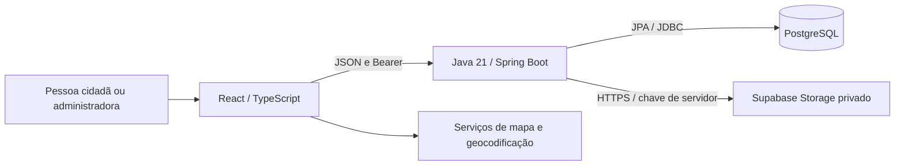

# Arquitetura do MVP

Base: backend `e0d47f2` e frontend `428ebfb`, conferidos em 27/10/2026. Este documento substitui, para a versão atual, os fluxos dos PDFs históricos.

## Componentes



O navegador não recebe a chave secreta do Storage nem credenciais de banco. O JWT do Zelar autentica na API e não equivale a uma sessão do Supabase. No desenvolvimento, o Vite encaminha `/api` à API. Esse proxy não existe no build estático; publicação exige reverse proxy ou política CORS definida explicitamente. Mapas/geocodificação são dependências externas da interface, distintas da persistência de ocorrências.

## Organização do backend

Pacote `app.zelar` dividido por domínio: `usuario`, `autenticacao`, `ocorrencia`, além de `config` e `shared`.

| Elemento | Responsabilidade | Exemplos |
| --- | --- | --- |
| Controller | Rotas, validação de entrada, identidade autenticada e resposta HTTP | `OcorrenciaController`, `FotografiaController` |
| DTO | Contrato explícito sem expor entidades e senhas | `CriarOcorrenciaRequest`, `OcorrenciaResponse` |
| Service | Casos de uso, autorização e transações | `OcorrenciaService`, `FotografiaService` |
| Entity / enum | Estado e invariantes do domínio | `Ocorrencia`, `StatusOcorrencia`, `Anexo` |
| Repository | Consultas, agregações e bloqueios | `OcorrenciaRepository`, `AnexoRepository` |
| Storage | Porta de armazenamento e adaptador HTTP | `FotografiaStorage`, `SupabaseFotografiaStorage` |
| Tratamento transversal | Segurança e erros padronizados | `SecurityConfig`, `GlobalExceptionHandler` |

`Localizacao` é embutida em `Ocorrencia`, sem tabela própria. Perfil administrativo é atributo da conta, sem tabela separada. DTOs de usuário usam `perfil`/`criadoEm`; banco usa `papel`/`data_cadastro`.

O frontend separa páginas/componentes, hooks/contexto, modelos de domínio e adaptadores `http`/`mock`. Conversões entre DTO HTTP e modelo da interface pertencem aos adaptadores. Simulação serve à demonstração, não à comprovação de backend.

## Cadastro de ocorrência e fotografia

```mermaid
sequenceDiagram
    actor C as Autor
    participant F as Frontend
    participant A as API
    participant D as PostgreSQL
    participant S as Storage privado
    C->>F: Categoria, descrição, coordenadas e foto opcional
    F->>A: POST /api/v1/ocorrencias (JSON + Bearer)
    A->>D: Validar conta e persistir ocorrência ENVIADA
    A-->>F: 201 + ID da ocorrência
    opt Foto selecionada e cliente integrado
        F->>A: POST /api/v1/ocorrencias/{id}/fotografia (multipart + Bearer)
        A->>D: Autorizar e reservar PENDENTE (commit)
        A->>S: Upload com chave gerada
        alt Upload e confirmação concluídos
            A->>D: Confirmar DISPONIVEL (commit)
            A-->>F: 201 + metadados + Location
        else Falha ou resultado incerto
            A->>D: Preservar reserva e sinalizar limpeza quando possível
            A-->>F: 503; ocorrência permanece criada
        end
    end
```

O fluxo da segunda etapa é o contrato já implementado no backend; o frontend de referência ainda bloqueia esse envio. Repetir a criação da ocorrência após falha de foto pode duplicar chamados. A integração deve conservar o ID e repetir só o upload, observando 409 e `possuiFotografia`.

## Consulta e administração

JWT validado → conta atual → escopo por perfil/autoria → consulta → DTO. Listagem é paginada e verifica disponibilidade de fotos em lote. Indicadores usam consulta agregada global. Status e prioridade usam leitura com bloqueio na mesma ocorrência, evitando sobrescrever alterações concorrentes dos outros campos.

Fotos são lidas pelo backend e retornadas com cabeçalhos de privacidade. Recuperação é eventual: o job tenta excluir objetos de operações interrompidas antes de remover seu metadado. [Regras e limites](../business-rules/REGRAS-MVP.md).

## Evolução

Manter separação entre contrato público, domínio e provedor. Mudanças de campos HTTP exigem atualização do adaptador frontend e testes. Não integrar a implementação alternativa S3 como se fosse o contrato atual do Supabase. Não alterar migrations já aplicadas para resolver evolução de schema: adicionar nova versão.

Fonte: [código da versão](https://github.com/Zelar-App/zelar.app-backend/tree/e0d47f21e0439437c031d7610de12dd4dbbb1cd2/src/main/java/app/zelar).
