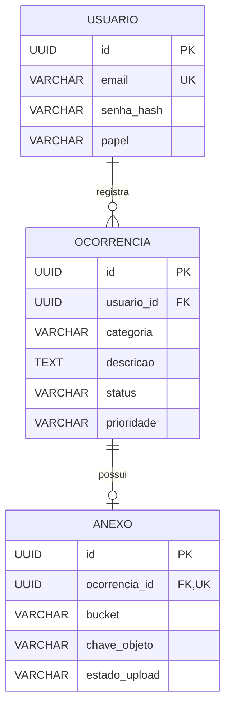

# Modelo relacional do MVP

Fonte normativa: [migrations V1–V5](https://github.com/Zelar-App/zelar.app-backend/tree/e0d47f21e0439437c031d7610de12dd4dbbb1cd2/src/main/resources/db/migration), backend `e0d47f2`, 27/10/2026. PostgreSQL; Hibernate valida o schema. Enums Java são persistidos como **VARCHAR com CHECK**, sem tipos ENUM nativos personalizados.

## usuario — V1

| Coluna | Tipo | Nulo | Regras |
| --- | --- | --- | --- |
| id | UUID | Não | PK |
| nome | VARCHAR(100) | Não | Validado também no DTO |
| email | VARCHAR(150) | Não | UNIQUE; formato validado na API |
| senha_hash | VARCHAR(255) | Não | Hash BCrypt; nunca senha reversível |
| telefone | VARCHAR(20) | Sim | Opcional |
| papel | VARCHAR(20) | Não | CHECK: CIDADAO, ADMINISTRADOR |
| data_cadastro | TIMESTAMP | Não | DEFAULT CURRENT_TIMESTAMP |

## ocorrencia — V2 e V3

| Coluna | Tipo | Nulo | Regras |
| --- | --- | --- | --- |
| id | UUID | Não | PK |
| descricao | TEXT | Não | API recusa texto branco; sem máximo de 1000 no DTO |
| status | VARCHAR(50) | Não | CHECK: ENVIADA, EM_ANALISE, RESOLVIDA |
| categoria | VARCHAR(50) | Não | CHECK dos sete valores abaixo |
| latitude | DOUBLE PRECISION | Não | API: -90 a 90 |
| longitude | DOUBLE PRECISION | Não | API: -180 a 180 |
| endereco_aproximado | VARCHAR(255) | Sim | Até 255 |
| prioridade | VARCHAR(20) | Sim | CHECK: BAIXA, MEDIA, ALTA |
| data_criacao | TIMESTAMP | Não | DEFAULT CURRENT_TIMESTAMP; entidade também atribui data |
| data_atualizacao | TIMESTAMP | Sim | Alteração efetiva de status ou prioridade |
| usuario_id | UUID | Não | FK `fk_ocorrencia_usuario` para usuario.id |

Categorias físicas/HTTP: `BURACO`, `ILUMINACAO`, `LIXO`, `ALAGAMENTO`, `CALCADA`, `SINALIZACAO`, `AMBIENTAL`. Rótulos da tela não alteram esses códigos. Coordenadas têm limites na API, não CHECK de intervalo na V2. As transições de status são regras de domínio, não verificadas apenas pelo CHECK de valores.

V3 cria `idx_ocorrencia_usuario_id`. Não há índice específico por status/prioridade/data documentado como existente. FK de usuário não especifica cascade na migration; não há endpoint de exclusão de conta.

## anexo — V5 / DB-09

| Coluna | Tipo | Nulo | Regras |
| --- | --- | --- | --- |
| id | UUID | Não | PK |
| ocorrencia_id | UUID | Não | FK + UNIQUE: no máximo um vínculo por ocorrência |
| bucket | VARCHAR(100) | Não | Letras minúsculas/números/hífen; primeiro caractere alfanumérico |
| chave_objeto | VARCHAR(255) | Não | UUID minúsculo + `.jpg` ou `.png` |
| tipo_conteudo | VARCHAR(50) | Não | image/jpeg ou image/png; extensão correspondente |
| tamanho_bytes | BIGINT | Não | 1 a 5.242.880 |
| largura / altura | INTEGER | Não | 1 a 8192 por lado; produto até 16.000.000 |
| estado_upload | VARCHAR(20) | Não | DEFAULT PENDENTE; CHECK dos três estados |
| data_criacao | TIMESTAMP | Não | DEFAULT CURRENT_TIMESTAMP |
| data_atualizacao | TIMESTAMP | Não | DEFAULT inicial CURRENT_TIMESTAMP; serviço atualiza depois |

Estados: `PENDENTE`, `DISPONIVEL`, `LIMPEZA_PENDENTE`. `UNIQUE(bucket, chave_objeto)` evita reutilizar objeto. FK `fk_anexo_ocorrencia` usa `ON DELETE RESTRICT`: não apaga objeto automaticamente. UNIQUE por ocorrência também bloqueia segundo envio enquanto há recuperação pendente. Índices de unicidade são criados pelas constraints; `idx_anexo_estado_atualizacao` apoia a recuperação.

Sem binário, nome original, credenciais ou URL assinada/pública no banco. O Storage mantém o conteúdo; constraints de tamanho/MIME não validam os bytes, responsabilidade da BE-13. Remover objeto antes do metadado é parte do protocolo de recuperação; SQL manual não executa esse protocolo.

## Histórico das migrations

| Versão | Finalidade |
| --- | --- |
| V1 | Cria usuario |
| V2 | Cria ocorrencia com FKs e CHECKs |
| V3 | Índice de ocorrências por usuário |
| V4 | Registra categorias/carga inicial do MVP; não insere senha ou administrador padrão |
| V5 | Cria anexo, constraints e índice de recuperação |

Não reescrever migrations já aplicadas. Novas mudanças pedem V6 ou versão posterior disponível. Datas SQL são TIMESTAMP sem timezone, DTOs usam LocalDateTime; evitar prometer offset universal. Flyway + Hibernate validate não substituem backup, nem validam conectividade com o Storage.

O PDF de entidades e o DER externo anteriores são históricos; este dicionário substitui suas divergências para a base referenciada.
