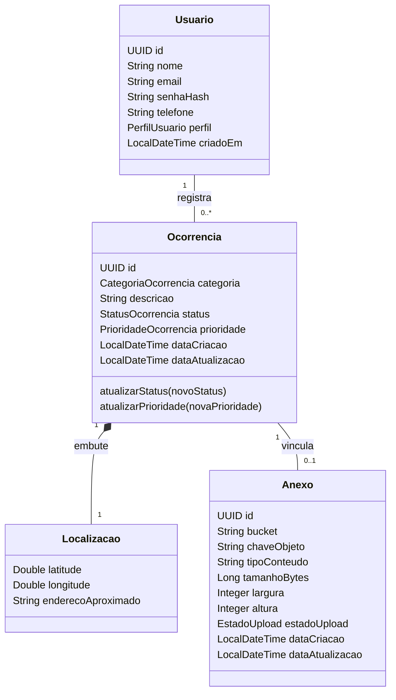

# Modelo conceitual do domínio

Backend `e0d47f2`, em 27/10/2026. Este modelo enfatiza entidades e invariantes; controllers, DTOs e adaptadores estão na [arquitetura](../architecture/ARQUITETURA.md). Não representa assinatura completa de todas as classes Java.

Enums: perfil `CIDADAO/ADMINISTRADOR`; categoria `BURACO/ILUMINACAO/LIXO/ALAGAMENTO/CALCADA/SINALIZACAO/AMBIENTAL`; status `ENVIADA/EM_ANALISE/RESOLVIDA`; prioridade `BAIXA/MEDIA/ALTA`; estado do upload `PENDENTE/DISPONIVEL/LIMPEZA_PENDENTE`.

Autorização administrativa é regra de serviço, não uma associação exclusiva de tabelas. Prioridade pode ser nula na criação. `Localizacao` não tem tabela própria. Uma fotografia pendente já ocupa o vínculo único; somente disponível é apresentada ao usuário. O banco mapeia `perfil` para `papel` e `criadoEm` para `data_cadastro`.

A cardinalidade de múltiplos anexos da documentação anterior foi substituída pelo contrato do MVP: uma fotografia opcional, conforme RF03 e DB-09/BE-13. [Decisões](../decisions/DECISOES-MVP.md).
